# TENSORA

**Finite element analysis for solid mechanics on Windows**

Build or import geometry, generate a mesh, solve locally, and inspect or export the results in one desktop application. TENSORA supports 2D and 3D linear statics, nonlinear deformation and fracture, and transient dynamics. The interface is available in English and Simplified Chinese.

TENSORA 是一款开源 Windows 固体力学有限元软件。在同一应用中完成几何建模、网格划分、本地求解和结果查看与导出，支持二维与三维线弹性静力学、非线性变形与断裂以及瞬态动力学，提供中英文界面。

[Windows download / Windows 下载](https://github.com/Sakihandser/TENSORA/releases/tag/v1.2.1) · [Workspaces / 功能](#workspaces) · [Documentation / 文档](#documentation) · [Full ASTM application study / ASTM 应用论文全文](#application-study-astm-e1820-01-seb)

## Quick start

1. Download **TENSORA-v1.2.1-windows-x64.zip** from the [release page](https://github.com/Sakihandser/TENSORA/releases/tag/v1.2.1) and extract the entire archive. / 从发布页下载并完整解压。
2. Run **TENSORA.exe** from the extracted folder. The launcher starts the local solver service and opens the application. / 在解压目录运行启动器，它会启动本地求解服务并打开应用。
3. For 2D statics, follow **Structure → Analysis → Results**. Enable **3D Analysis**, **Deformation**, or **Blast** in **Specialties** to switch workspaces. / 二维静力学按**结构绘制 → 计算 → 计算结果**操作，其他工作区从**专业计算**启用。

The Windows x64 package includes the native solvers, Node.js, Chromium, Gmsh, CalculiX and the OpenMP runtime. PhAST requires its own Python environment. GPU solving requires an OpenCL driver with FP64 support. / 安装包自带求解器及运行环境。PhAST 需要单独的 Python 环境，GPU 求解需要支持 FP64 的 OpenCL 驱动。

## Workspaces

| Workspace / 工作区 | Analysis and results / 分析与结果 | Guide / 指南 |
| --- | --- | --- |
| **2D statics / 二维静力学** | Plane stress and plane strain on TRI3 meshes. Draw profiles and voids, assign materials and directional constraints, and apply point, distributed or body loads. Optional ZZ adaptive refinement. / 绘制轮廓和空洞，设置材料、方向约束和载荷，使用 TRI3 求解平面应力或平面应变，支持 ZZ 自适应加密。 | [Adaptive mesh / 自适应网格](docs/ADAPTIVE_MESH.md) |
| **3D statics / 三维静力学** | Small-strain elasticity on TET4 meshes. Import STEP or build, extrude and cut solids with OpenCASCADE. Assign materials by volume and inspect stress, strain and displacement on movable sections. / 导入 STEP 或建立、拉伸与切削实体，按体域赋材，以 TET4 求解小变形线弹性，在可移动剖面上查看应力、应变和位移。 | [3D analysis / 三维计算](docs/SOLID_3D.md) |
| **Deformation and fracture / 变形与断裂** | CalculiX for quasi-static J2 plasticity and finite deformation, with increment playback. Optional PhAST for 2D plane-strain AT2 brittle fracture. / 使用 CalculiX 求解准静态 J2 塑性和有限变形并回放增量，可选 PhAST 求解二维平面应变 AT2 脆性断裂。 | [Deformation / 变形](docs/DEFORMATION.md) |
| **Transient dynamics / 瞬态动力学** | Prescribed pressure or radial gas–solid coupling around a cavity, with contour playback and time histories. / 支持空腔压力与径向气固耦合，查看云图和时程。 | [Dynamics / 动力学](docs/BLAST_DYNAMICS.md) |

The *main* source branch supports defining 3D point, edge, line and partial-face conditions on CAD geometry before meshing. It also supports uniform and linearly varying line loads, linear surface traction or pressure with multiple coordinate gradients, and load arrows that show local direction and relative intensity. / *main* 源码分支支持划分网格前设置三维 CAD 点、边、线和局部面条件，可施加均布或线性线载荷，以及按多轴梯度变化的面力和压力，并显示载荷方向和相对强度。

Workspaces share material cards and save models as JSON. 2D results export as tables and figures. 3D results export as JSON. / 工作区共享材料卡，模型保存为 JSON。二维可导出表格与图件，三维结果可导出 JSON。

## Application views

### 2D statics, safety and materials / 二维静力学、安全校核与材料

| Mode I crack, opening / 一型裂纹，张开 | Mode II crack, in-plane shear / 二型裂纹，面内剪切 |
| --- | --- |
| 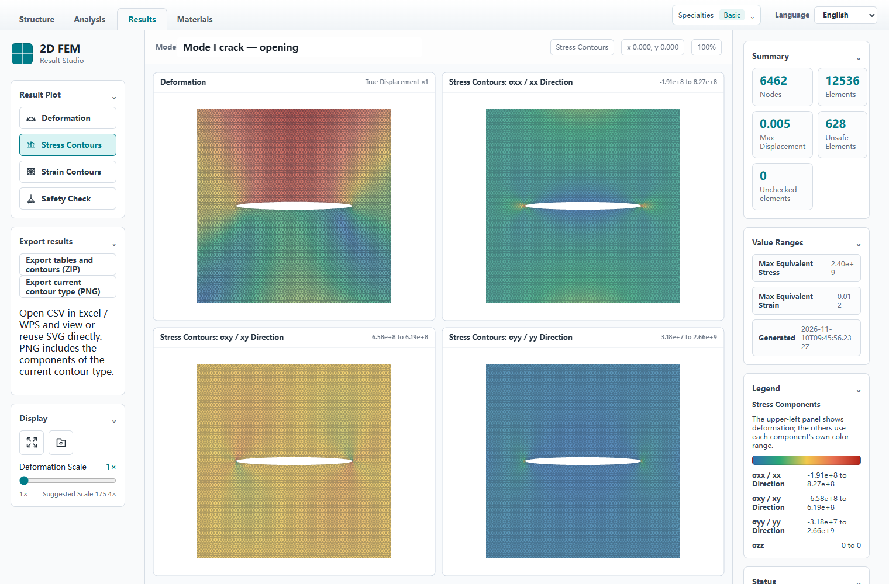 | 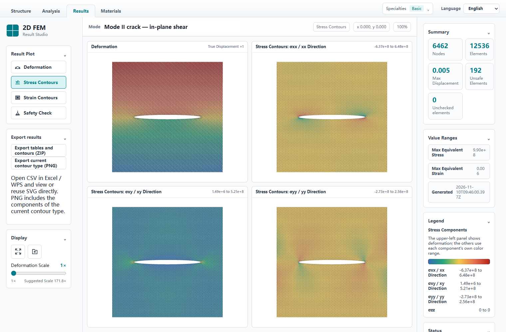 |

| Strength-based safety check / 基于强度准则的安全校核 | Shared material library / 共享材料库 |
| --- | --- |
| 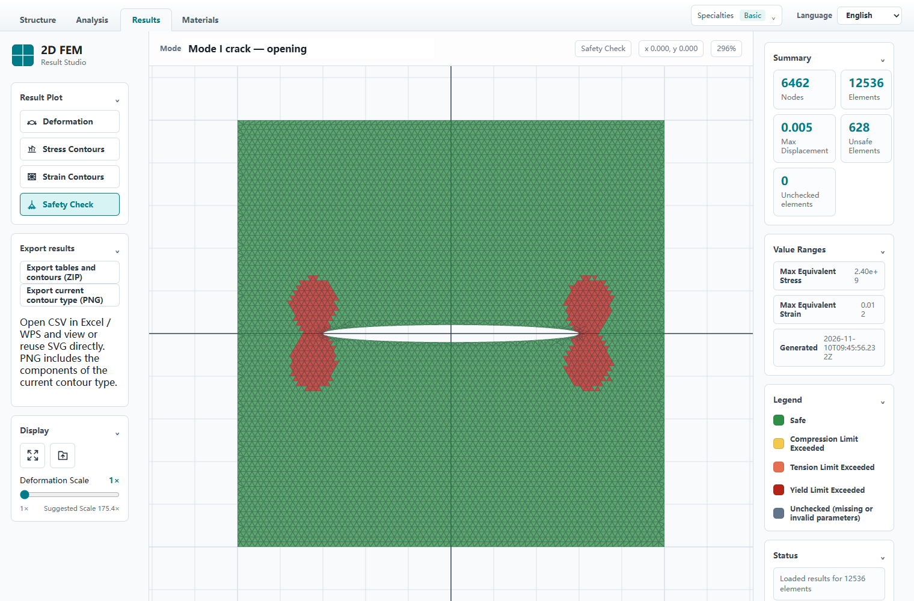 | 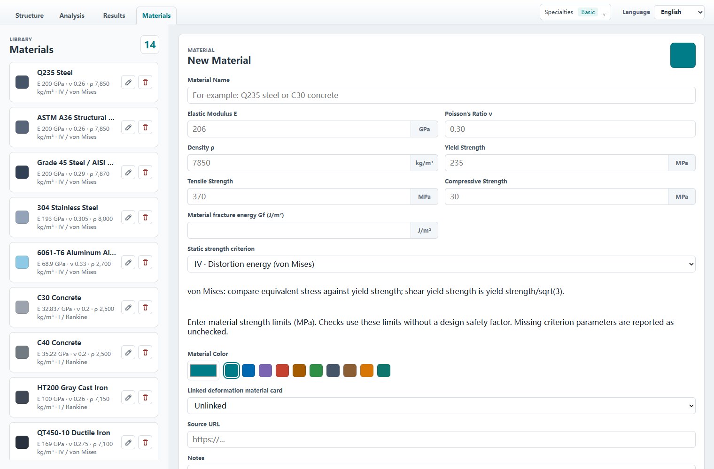 |

### 3D CAD, tetrahedral mesh and interior contours / 三维 CAD、四面体网格与内部云图

| CAD preview / CAD 预览 | Mesh and loads / 网格与载荷 |
| --- | --- |
| 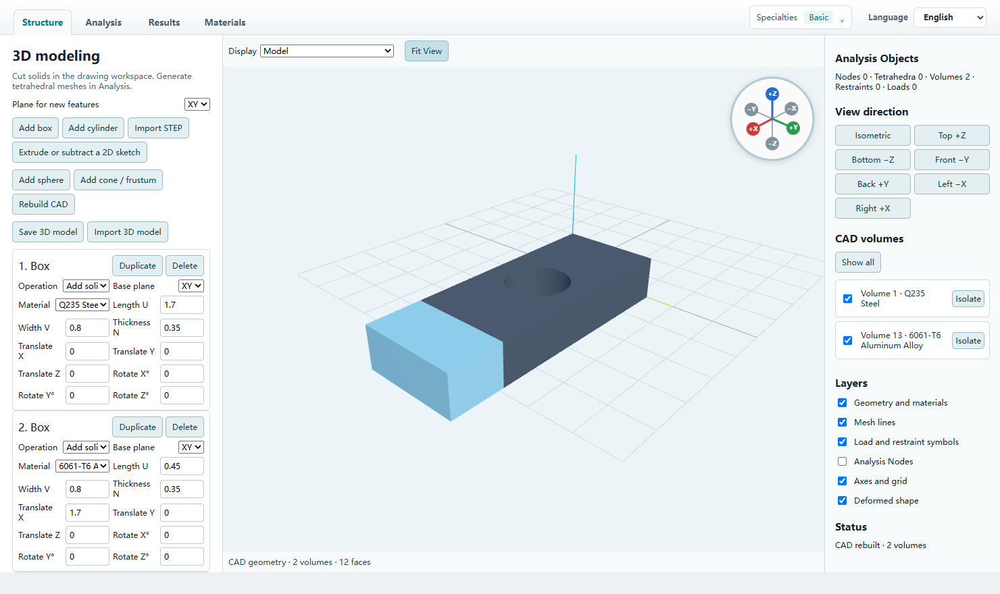 | 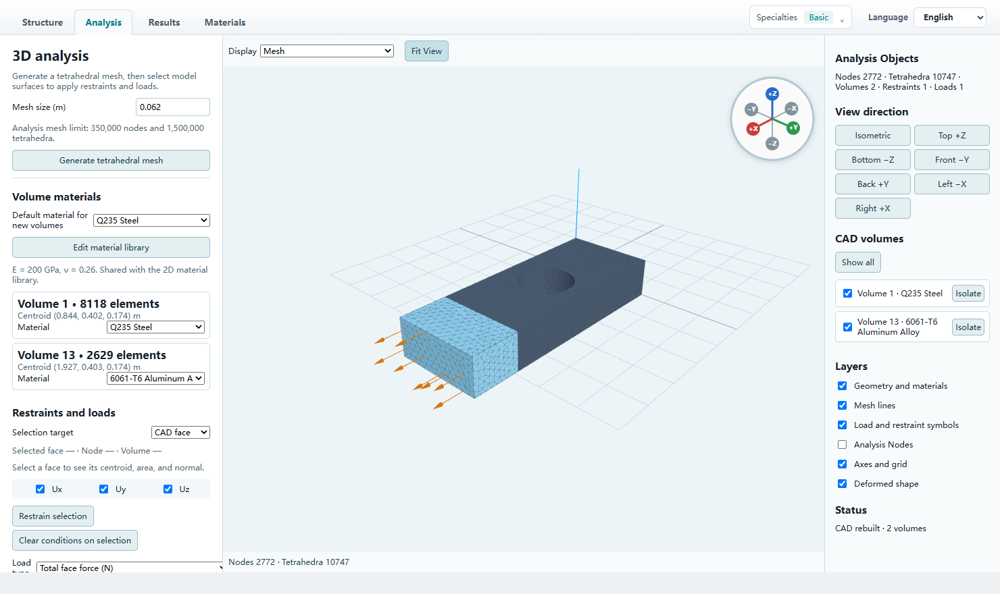 |

The XY mid-thickness section (z = 0.175 m) shows von Mises stress concentrating around the hole. The nearby YZ section (x = 1.22 m) shows how stress varies through the thickness. Both sections share a color scale and can be moved by coordinates or by dragging the viewport handle. / XY 中厚面（z = 0.175 m）显示孔缘的 von Mises 应力集中，附近的 YZ 横剖面（x = 1.22 m）显示应力沿厚度的变化。两个剖面共用色标，可通过输入坐标或拖动视窗手柄移动。

**Sections only / 仅显示剖面**

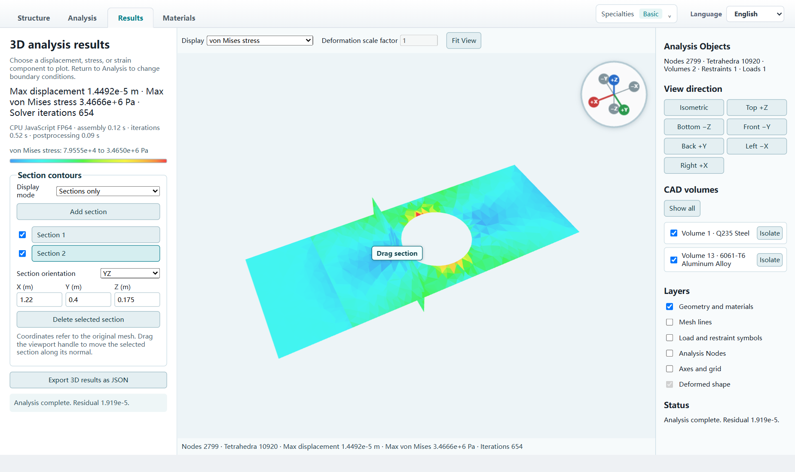

**Sections and translucent shell / 剖面与透明外壳**

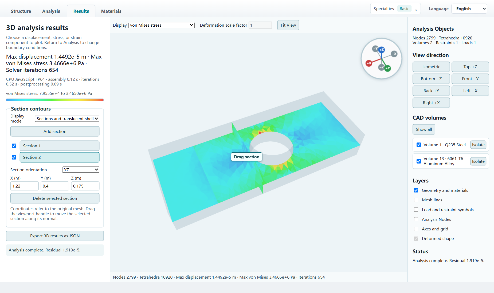

### Damage and deformation / 损伤变形

| AT2 phase-field fracture / AT2 相场断裂 | J2 plastic deformation / J2 塑性变形 |
| --- | --- |
| 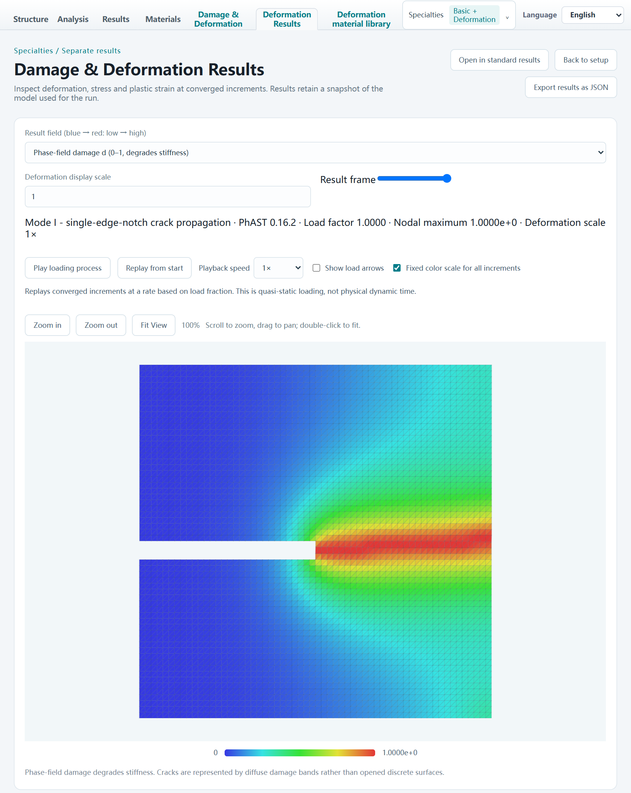 | 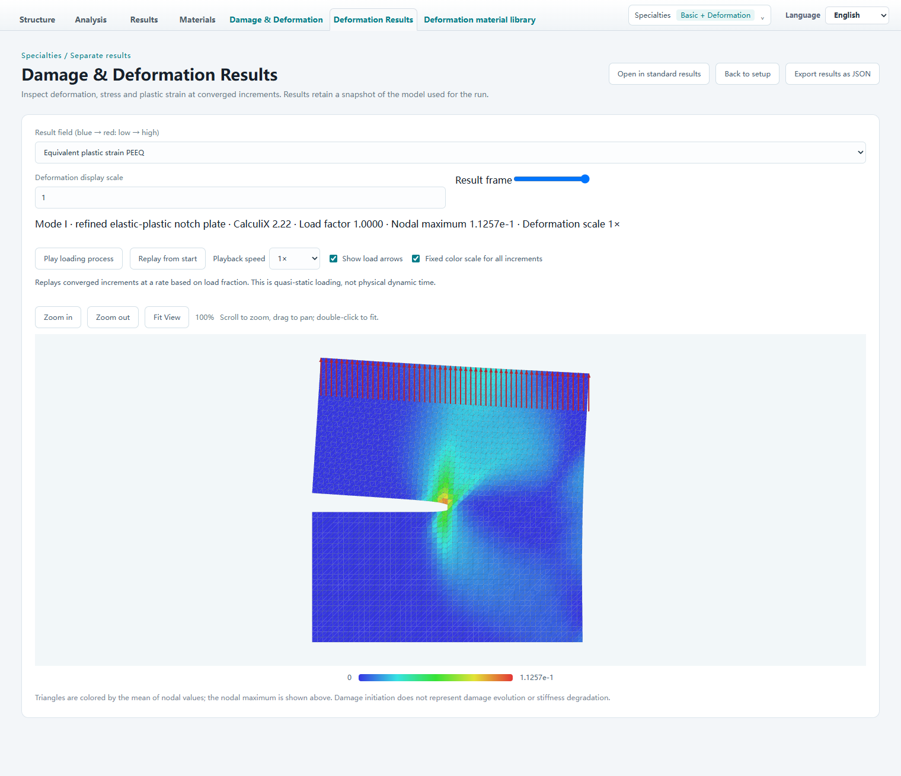 |

PhAST solved the Mode I notched plate on a refined mesh of 7,020 TRI3 elements, up from 780. The longest element edge is 0.236 mm for a phase-field length of 1.0 mm. At the 40th and final converged increment, the damage band extends from the initial notch to the opposite edge. The J2 example uses 5,356 triangles to show the equivalent plastic strain near the notch. / I 型缺口板的求解网格从 780 个 TRI3 单元加密到 7,020 个，由 PhAST 重新求解。单元最长边为 0.236 mm，相场长度为 1.0 mm。第 40 个收敛增量为最终结果，损伤带从初始缺口延伸至对侧边界。J2 算例用 5,356 个三角形单元显示缺口附近的等效塑性应变。

### Blast dynamics / 爆破动力学

At 110 µs, the damage contour shows how damage is distributed around the cavity. The viewer also displays the cavity pressure history and supports frame playback. / 110 微秒时刻的损伤云图展示空腔周围的损伤分布。结果页同时显示空腔压力时程，并支持逐帧回放。

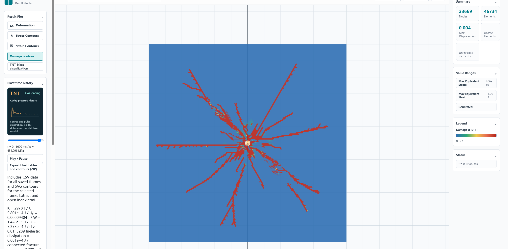

## Solver capacity

The v1.2.1 3D workspace supports up to **350,000 nodes and 1,500,000 tetrahedra**. Gmsh HXT uses up to eight CPU threads. Automatic solver selection uses native OpenMP CPU iterations from 80,000 tetrahedra and tries OpenCL FP64 from 1.2 million, with CPU fallback. Assembly and postprocessing run on the CPU.

v1.2.1 的三维网格上限为 **35 万节点、150 万四面体**。Gmsh HXT 最多使用 8 个 CPU 线程。自动求解从 8 万单元起使用 OpenMP CPU 迭代，从 120 万单元起尝试 OpenCL FP64，失败时回退到 CPU。组装与后处理在 CPU 上运行。

The release was tested end to end on a mesh of about 1.41 million tetrahedra. On that mesh, the iteration phase took 5.99 s on an RTX 4070 Laptop GPU and 7.73 s with the native CPU solver. / 发布验证使用了约 141 万四面体的算例。同一网格上，RTX 4070 Laptop GPU 的迭代耗时为 5.99 秒，原生 CPU 求解器为 7.73 秒。

## Documentation

- [Windows launcher / Windows 启动器](docs/WINDOWS_LAUNCHER.md) · [3D workflow and limits / 三维操作与限制](docs/SOLID_3D.md) · [Constitutive models / 本构模型](docs/CONSTITUTIVE_MODELS.md)
- [Project structure / 项目结构](docs/PROJECT_STRUCTURE.md) · [Result export format / 结果导出格式](docs/CALCULATION_EXPORT_FORMAT.md) · [2D GPU scope / 二维 GPU 计算范围](docs/GPU_COMPUTE.md) · [Gas–solid coupling / 气固耦合](docs/GAS_COUPLING.md)
- [Changelog / 更新日志](CHANGELOG.md) · [All releases / 全部发布](https://github.com/Sakihandser/TENSORA/releases)
- [Main branch / 桌面仿真版](https://github.com/Sakihandser/TENSORA/tree/main) · [Machine-learning branch / 网格预测版](https://github.com/Sakihandser/TENSORA/tree/machine-learning) adds dataset generation and GNN mesh-size prediction with finite element verification. / 提供数据集生成、GNN 网格尺寸预测和有限元验证。

For source development, use Node.js 24. / 从源码运行需要 Node.js 24。

~~~powershell
node server.js
node --test tests/solid3d.test.js tests/deformation.test.js tests/i18n.test.js
~~~

## Scope and licensing

TENSORA is intended for teaching, mechanics research and reproducible numerical experiments. Engineering analyses require independent checks of material inputs, units, boundary conditions, mesh convergence and results. / TENSORA 面向教学、计算力学研究和可复现的数值试验。用于工程分析时，需独立核验材料、单位、边界条件、网格收敛和计算结果。

Original code is licensed under [MIT](LICENSE). Bundled components retain their own terms, including [Triangle](src/vendor/triangle-wasm/THIRD_PARTY_NOTICES.txt), [OpenRadioss](third_party/openradioss-jh2/README.md), Gmsh and CalculiX. / 原创代码采用 [MIT](LICENSE) 许可证，随附组件适用各自许可。

## Application study: ASTM E1820-01 SE(B)

[PDF report](docs/validation/astm-e1820-seb/report.pdf) · [Word report](docs/validation/astm-e1820-seb/report.docx) · [Numerical results (CSV)](docs/validation/astm-e1820-seb/geometry-factors.csv) · [TENSORA revision used in the study](https://github.com/Sakihandser/TENSORA/commit/79bbfb1d731287e3dffe6761f1461dfbb0afbed4)

### Finite Element Reproduction and Refinement of the ASTM E1820 SE(B) Geometry Factor

**Mingze Hong**

#### Abstract

The single-edge bend [SE(B)] geometry factor in ASTM E1820-01 was evaluated with the author’s TENSORA finite element solver. A symmetry half-model represented a sharp through-thickness crack. Fourteen crack lengths over 0.15 ≤ a/W ≤ 0.80 were used to fit the geometry factors, and four additional lengths were reserved for validation. Domain integration provided the two-dimensional and interior three-dimensional factors. Crack opening displacement (COD) over a prescribed distance from the tip provided an equivalent factor at the free surface.

The two-dimensional results agreed closely with the ASTM reference. At a/W = 0.50, the fitted factors at quarter thickness and mid-thickness exceeded the reference by 3.81% and 5.10%, respectively. The surface equivalent was more sensitive to the COD sampling window than to mesh refinement. The resulting fits describe the specimen and boundary conditions analyzed here.

**Keywords.** single-edge bend specimen, stress intensity factor, domain integral, crack-front corner, Chebyshev approximation

#### 1. ASTM reference and normalization

ASTM E1820-01 Annex A1 [1] gives the Mode I stress intensity factor for the SE(B) specimen. Here a is crack length, W is specimen depth, B is thickness, P is the total load, and S is the full support span. For a specimen without side grooves, the net thickness equals B and Eq. (A1.2) reduces to Eq. (1).

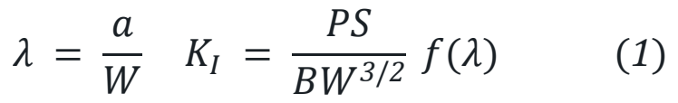

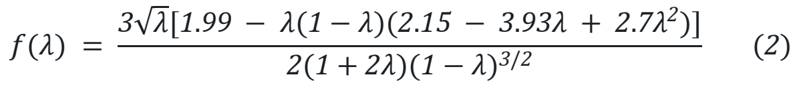

Equation (2) is the geometry function in ASTM Eq. (A1.3). Srawley [2] gives a wide-range calibration for the same specimen type. The model uses S/W = 4 and B/W = 0.50. The reference is evaluated over the study interval for comparison with the elastic simulations. That interval describes the numerical study and does not specify the qualification range for a fracture toughness test.

*Table 1. Specimen dimensions and analysis parameters.*

| Parameter | Value | Description |
| --- | --- | --- |
| W / B | 40 / 20 mm | No side grooves, B/W = 0.50 |
| S / 2L | 160 / 180 mm | Support span / overall length |
| E / ν | 210 GPa / 0.30 | Isotropic linear elasticity |
| P / a | 1,000 N / λW | Downward load, crack along +y |
| Section z | 0 / 5 / 10 mm | Free surface to midplane |

#### 2. Specimen geometry and boundary conditions

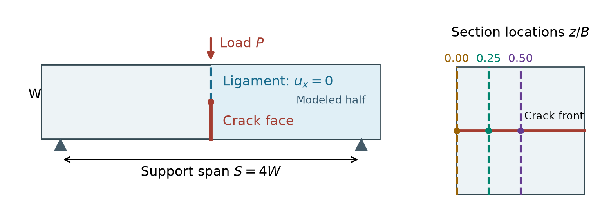

*Figure 1. SE(B) specimen and modeled half. The right panel locates the crack front and the three sections on the x = 0 plane.*

##### 2.1 Sharp crack representation

The x axis follows the beam, y runs from the tensile edge to the loaded edge, and z measures distance through the thickness. On the symmetry plane x = 0, the segment 0 ≤ y < a is traction-free. The remaining ligament a ≤ y ≤ W is constrained in uₓ. The two-dimensional crack tip is at (0, a); the three-dimensional front spans the full thickness. Reflection across x = 0 gives a total opening of 2uₓ and maintains continuity across the ligament.

This representation introduces neither a finite notch width nor a tip radius. The change in boundary condition at y = a defines the sharp crack on the half-model.

##### 2.2 Loading and support

The two-dimensional model carries a downward load of P/2 at (0, W), equivalent to 25,000 N/m per unit thickness. At (S/2, 0), only uᵧ is fixed. The three-dimensional half-model applies the uniform line load −P/(2B) at (0, W, z) with consistent nodal forces totaling −500 N. The support line (S/2, 0, z) fixes uᵧ. Fixing uz at its z = 0 endpoint removes rigid translation through the thickness. The thickness faces are traction-free.

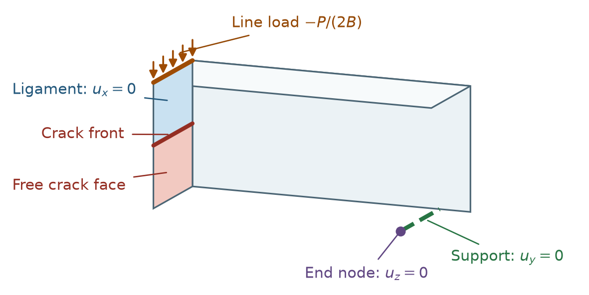

*Figure 2. Line load, support, constrained ligament, and traction-free crack face in the three-dimensional half-model.*

#### 3. Finite element meshes and solution

Gmsh was used to construct a two-dimensional section bounded by six edges, with the symmetry boundary split at the crack tip. The section was extruded through the thickness for the three-dimensional model. Unstructured conforming meshes were refined by distance to the tip in 2D and to the crack front in 3D, placing the tip and front on element boundaries.

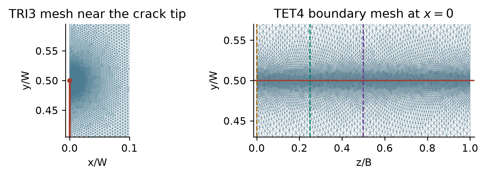

*Figure 3. Meshes at a/W = 0.50. The horizontal line marks the front on the TET4 boundary mesh. The vertical lines mark the extraction sections.*

*Table 2. Mesh sizes and element counts for the modeled half.*

| Element | Level | Far field h (mm) | Front h₀ (mm) | Elements | Use |
| --- | --- | --- | --- | --- | --- |
| TRI3 | L0 | 0.3920 | 0.0300 | 55,892–56,076 | Check |
| TRI3 | L1 | 0.2760 | 0.0200 | 112,622–113,077 | Check |
| TRI3 | L2 | 0.1960 | 0.0136 | 223,211–224,050 | Main |
| TET4 | L0 | 1.2800 | 0.1320 | 201,505 | Check |
| TET4 | L1 | 1.0200 | 0.0920 | 410,761–412,212 | Check |
| TET4 | L2 | 0.8320 | 0.0680 | 780,197–781,981 | Main |
| TET4 | L3 | 0.8080 | 0.0540 | 1,090,890 | Check |

The TRI3 and TET4 elements use linear displacement interpolation and constant strain. Each node has two displacement degrees of freedom in 2D and three in 3D. The TENSORA C++ solver uses Eigen’s sparse LDLᵀ factorization for plane stress and plane strain. The solid3d module assembles the TET4 stiffness matrix and solves it with a double-precision preconditioned conjugate-gradient method parallelized with OpenMP.

Table 2 lists the elements actually solved. All mesh levels use the same geometry and boundary conditions. The crack-tip region uses standard linear elements.

#### 4. Extraction of geometry factors

##### 4.1 Domain integral for 2D and interior 3D sections

For virtual crack extension along +y, the element displacement gradient gives stress σ and strain energy density U. Let Ωₕ denote the integration domain of the half-model, q the virtual-extension weight, and ξ the front-length normalization. The domain integral [3,4] is

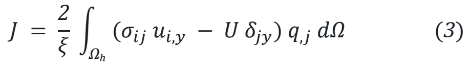

The factor of two accounts for both halves. The radial weight is one for r ≤ R/4 and zero for r ≥ R, with a cubic transition. In 2D, ξ = 1. In 3D, the radial weight is multiplied by a symmetric triangular window along z, and ξ is its discrete integral along the crack front. The derivative of q with respect to z is retained. The elementwise linear interpolation of q gives a constant gradient for integration.

Five radii were tested: R/W = 0.035, 0.055, 0.075, 0.100, and 0.125. Each was scaled by min(1, λ/0.25, (1−λ)/0.25) to keep the domain clear of the external boundaries at short and long cracks. The reported factor averages the middle three radii. For interior 3D sections, normalized J was regressed against squared window width using half-widths of 0.10B, 0.15B, and 0.20B. The intercept estimates J at zero window width.

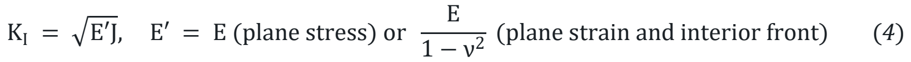

##### 4.2 Free-surface COD equivalent

At z = 0 the crack front meets the free surface. The corner field generally differs from the classical inverse-square-root crack-front field [5]. A displacement-based equivalent was calculated by fitting the full opening Δ = 2uₓ to √r through the origin, where r = a−y. The fit used 61 interpolated points over 0.020 ≤ r/W ≤ 0.040.

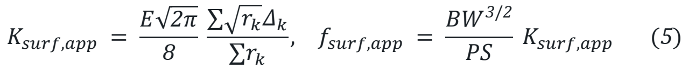

Equation (5) uses the classical plane-stress opening relation to scale the fitted slope [6]. The window is a reporting choice, spanning 0.8–1.6 mm, with four or five actual crack-face nodes in the main meshes. Its sensitivity is assessed in Section 9. This factor represents the opening over that interval.

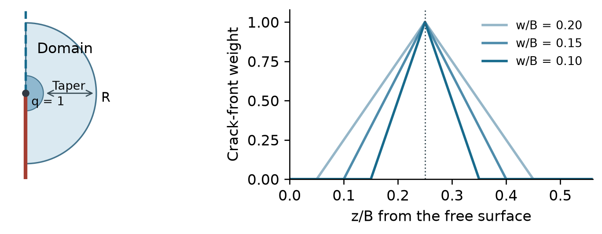

*Figure 4. Radial domain and three crack-front weight functions centered at quarter thickness.*

#### 5. Two-dimensional fields and compliance check

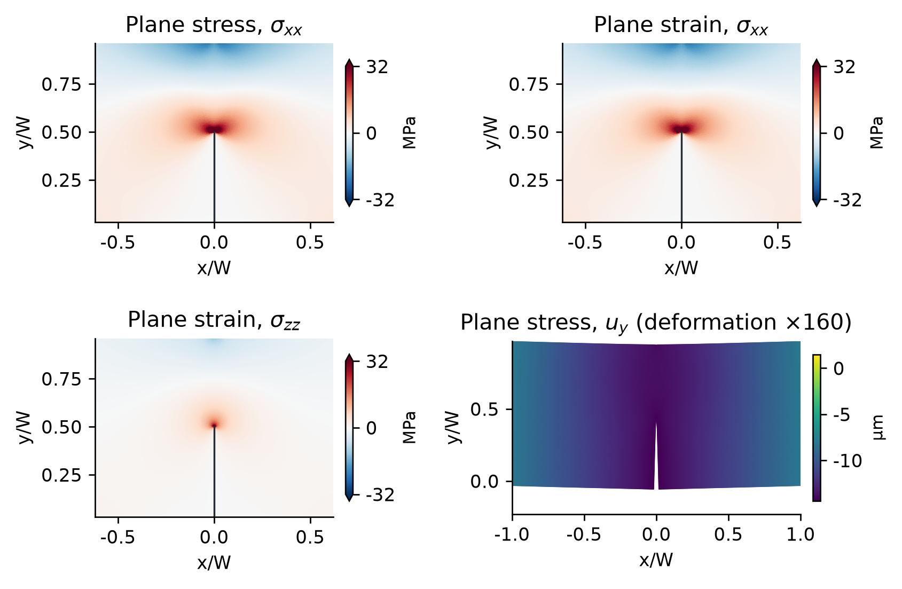

*Figure 5. Two-dimensional fields at a/W = 0.50. The left half is reflected from the computed right half. The stress panels use the same clipped color scale.*

The opening stress fields in plane stress and plane strain nearly coincide. The largest difference in f over the 18 crack lengths is 0.002%. The constitutive choice chiefly affects displacement and through-thickness stress: plane stress gives σzz = 0, while plane strain generally gives nonzero σzz. Each factor uses its corresponding E′. The deformation plot is magnified to show bending and opening.

##### 5.1 Independent load-line compliance check

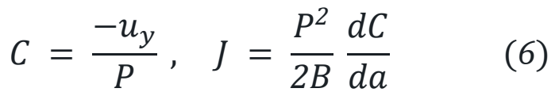

The derivative of load-line compliance was estimated by central difference from λ = 0.495 and 0.505. At λ = 0.50, the compliance factors are 2.64076 for plane stress and 2.64150 for plane strain. They are 0.060% and 0.033% below the corresponding domain-integral values.

Across the 18 crack lengths, the plane-stress values deviate from ASTM by −1.82% to +0.35%. Mesh refinement and the compliance calculation quantify numerical sensitivity. The effects of the reference approximation, idealized support, and specimen details cannot be isolated with these simulations.

#### 6. Three-dimensional stress fields

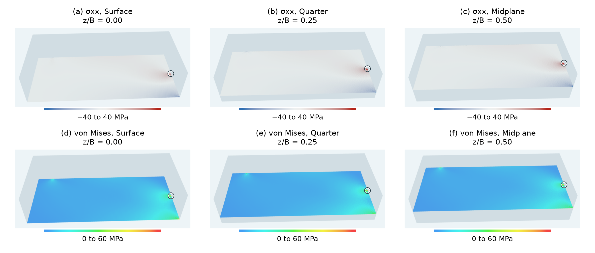

*Figure 6. TENSORA stress sections and transparent specimen shell at a/W = 0.50.*

The upper row shows opening stress σxx, and the lower row shows von Mises stress. The three XY sections lie 0, 5, and 10 mm from the same free surface. Circles mark the crack tip. Each stress measure has a shared color scale across the sections, with values outside its limits shown in the end colors.

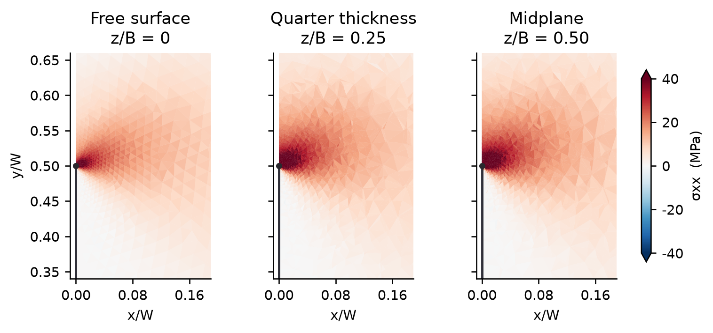

*Figure 7. Opening stress near the crack tip at the three thickness positions.*

The section planes intersect the tetrahedral mesh, and each intersected element contributes its constant stress. The same coordinate limits and color scale are used in each panel. The tensile concentration at the crack tip is visible in red. Its displayed intensity is bounded by the color scale, while the point stress in the ideal sharp-crack model increases with refinement.

#### 7. Finite element geometry factors

*Table 3. Geometry factors for the 14 crack lengths used in fitting.*

| λ | ASTM | Plane stress | Plane strain | Surface COD | Quarter thickness | Midplane |
| --- | --- | --- | --- | --- | --- | --- |
| 0.150 | 1.0169 | 0.9984 | 0.9984 | 0.9284 | 1.0399 | 1.0452 |
| 0.200 | 1.1749 | 1.1616 | 1.1616 | 1.0837 | 1.2150 | 1.2236 |
| 0.250 | 1.3390 | 1.3295 | 1.3295 | 1.2416 | 1.3932 | 1.4055 |
| 0.300 | 1.5212 | 1.5133 | 1.5133 | 1.4120 | 1.5873 | 1.6028 |
| 0.350 | 1.7318 | 1.7231 | 1.7231 | 1.6086 | 1.8064 | 1.8262 |
| 0.400 | 1.9818 | 1.9703 | 1.9703 | 1.8363 | 2.0647 | 2.0879 |
| 0.450 | 2.2855 | 2.2699 | 2.2699 | 2.1123 | 2.3775 | 2.4066 |
| 0.500 | 2.6625 | 2.6423 | 2.6424 | 2.4566 | 2.7638 | 2.7980 |
| 0.550 | 3.1424 | 3.1185 | 3.1185 | 2.8944 | 3.2559 | 3.2977 |
| 0.600 | 3.7716 | 3.7462 | 3.7463 | 3.4684 | 3.9022 | 3.9551 |
| 0.650 | 4.6279 | 4.6052 | 4.6052 | 4.2590 | 4.7829 | 4.8487 |
| 0.700 | 5.8504 | 5.8369 | 5.8370 | 5.3958 | 6.0331 | 6.1170 |
| 0.750 | 7.7101 | 7.7157 | 7.7159 | 7.1468 | 7.9342 | 8.0415 |
| 0.800 | 10.8032 | 10.8414 | 10.8417 | 10.1167 | 11.0665 | 11.1979 |

*Table 4. Geometry factors for the four holdout crack lengths.*

| λ | ASTM | Plane stress | Plane strain | Surface COD | Quarter thickness | Midplane |
| --- | --- | --- | --- | --- | --- | --- |
| 0.175 | 1.0960 | 1.0802 | 1.0802 | 1.0077 | 1.1275 | 1.1350 |
| 0.375 | 1.8511 | 1.8412 | 1.8412 | 1.7163 | 1.9302 | 1.9511 |
| 0.625 | 4.1647 | 4.1400 | 4.1400 | 3.8303 | 4.3056 | 4.3636 |
| 0.775 | 9.0414 | 9.0614 | 9.0615 | 8.4198 | 9.2966 | 9.4038 |

The main two-dimensional meshes contain 223,211–224,050 triangles, and the three-dimensional meshes contain 780,197–781,981 tetrahedra. Under the selected dimensions and load, f equals the numerical value of Kᵢ in MPa√m.

Midplane f exceeds the quarter-thickness value by 0.51% to 1.39% at the calculated crack lengths. The surface column is the COD equivalent defined by Eq. (5).

#### 8. Fitted corrections and applicability

The common factor √λ/(1−λ)³ᐟ² was taken out before fitting the remaining function with Chebyshev polynomials by least squares. Degrees two through seven were assessed by leave-one-out validation, selecting the lowest degree close to the minimum relative error. The four lengths in Table 4 were reserved for the holdout test.

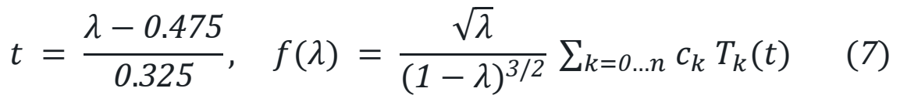

The polynomials satisfy T₀ = 1, T₁ = t, and Tₖ₊₁ = 2tTₖ − Tₖ₋₁. Table 5 lists coefficients by ascending degree. The fits cover 0.15 ≤ λ ≤ 0.80 at S/W = 4 for the geometry, boundary conditions, and extraction methods described here.

*Table 5. Chebyshev coefficients for the five fitted curves.*

| Coeff. | Plane stress | Plane strain | Surface COD | Quarter thickness | Midplane |
| --- | --- | --- | --- | --- | --- |
| c0 | 1.44587390 | 1.44588708 | 1.34518262 | 1.50532007 | 1.52063570 |
| c1 | -0.44450674 | -0.44449879 | -0.41711190 | -0.47588318 | -0.47497678 |
| c2 | 0.10097079 | 0.10097482 | 0.09465938 | 0.09636075 | 0.09370521 |
| c3 | -0.02225387 | -0.02225232 | -0.01627803 | -0.02226673 | -0.02187668 |
| c4 | 0.00503040 | 0.00503073 | 0.00516289 | 0.00373608 | 0.00301190 |
| c5 | -0.00115537 | -0.00115358 | — | -0.00059901 | -0.00067070 |
| c6 | 0.00024484 | 0.00024271 | — | — | — |
| c7 | -0.00006044 | -0.00006102 | — | — | — |

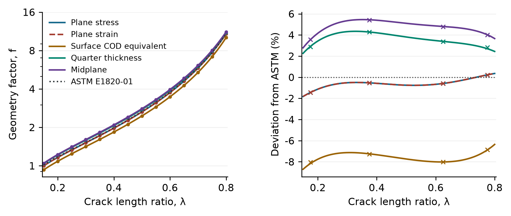

*Figure 8. Fits and ASTM reference on a logarithmic vertical scale (left), and relative deviations from ASTM (right). Markers are finite element results: circles show the fitting lengths and crosses show the holdout lengths.*

The largest holdout error relative to the corresponding finite element value was 0.120%.

##### 8.1 Expanded fitting formulas

Equation (8) gives the ASTM reference with its bracket expanded in powers of λ. Equations (9)–(13) are the fitted alternatives, converted from Eq. (7) to the same form so they can be evaluated directly at λ = a/W.

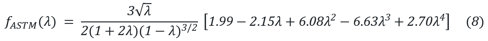

**Two-dimensional plane stress**

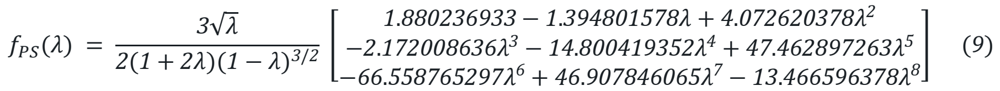

**Two-dimensional plane strain**

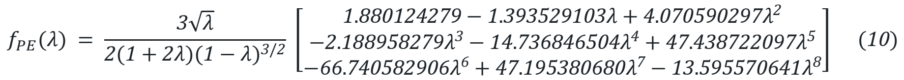

**Free-surface COD equivalent (z/B = 0)**

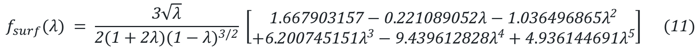

**Quarter thickness (z/B = 0.25)**

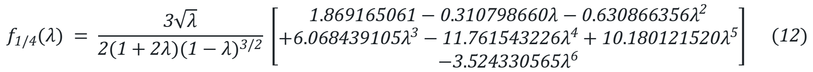

**Midplane (z/B = 0.50)**

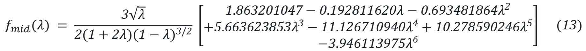

Full-precision fitted coefficients were used for the conversion. The printed coefficients are rounded to nine decimal places. The 3D fits use B/W = 0.50 and ν = 0.30.

##### 8.2 Comparison with ASTM E1820-01

Let Q be the polynomial in brackets after factoring out the common multiplier in Eqs. (8)–(13). The relative correction to the ASTM reference can be computed directly from Q.

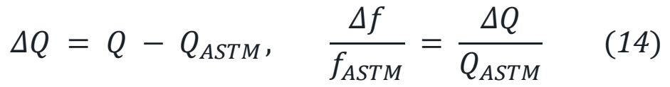

Table 6 shows the correction at λ = 0.50 and its range over the fitted interval. The extrema include stationary points in the interval and both endpoints.

*Table 6. Fitted corrections relative to ASTM E1820-01.*

| Result | Q(0.50) | ΔQ(0.50) | f(0.50) | Δf/f at 0.50 | Deviation over interval |
| --- | --- | --- | --- | --- | --- |
| ASTM reference | 1.775000 | 0.000000 | 2.662500 | 0.000% | 0.000% |
| Plane stress | 1.761562 | -0.013438 | 2.642344 | -0.757% | -1.825% to +0.354% |
| Plane strain | 1.761579 | -0.013421 | 2.642369 | -0.756% | -1.825% to +0.356% |
| Surface COD | 1.637606 | -0.137394 | 2.456409 | -7.740% | -8.711% to -6.360% |
| Quarter thickness | 1.842569 | +0.067569 | 2.763853 | +3.807% | +2.261% to +4.344% |
| Midplane | 1.865506 | +0.090506 | 2.798259 | +5.099% | +2.782% to +5.453% |

The plane-stress and plane-strain fits cross the reference near λ = 0.738. Both interior 3D curves stay above ASTM throughout the interval, with the midplane consistently higher than the quarter-thickness section.

At all 18 calculated crack lengths, the COD equivalent stays below the ASTM reference and both interior values for each of the three tested windows. The magnitude of the difference depends on the window.

The fitted corrections describe the elastic model and extraction conventions used in this study.

#### 9. Mesh refinement and extraction sensitivity

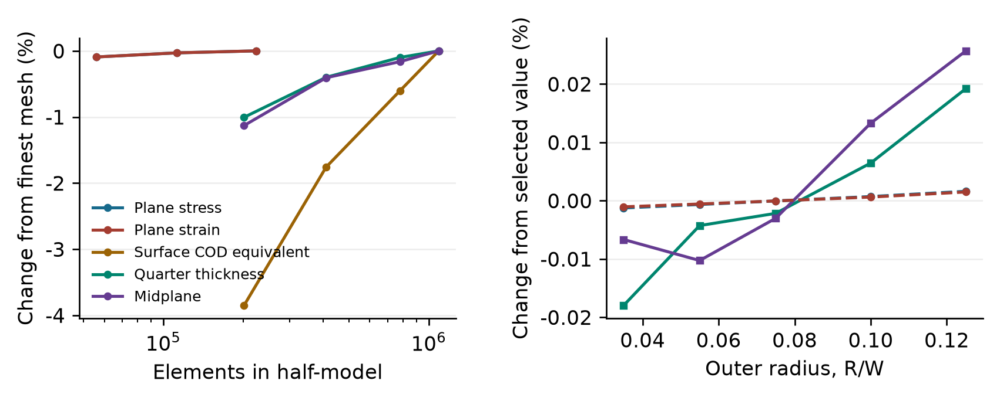

*Figure 9. Mesh refinement and sensitivity to the outer radius of the domain integral at λ = 0.50.*

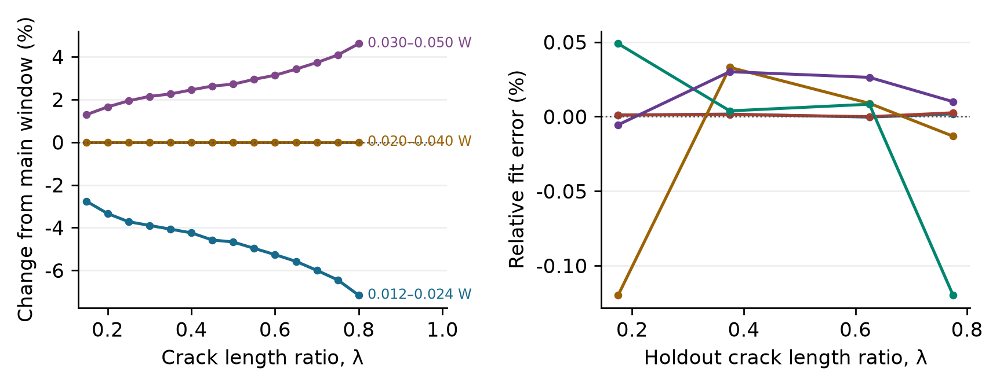

*Figure 10. Surface COD window sensitivity and fit errors at the four holdout crack lengths.*

*Table 7. Relative fitting and holdout errors against finite element results.*

| Error metric | Plane stress | Plane strain | Surface COD | Quarter thickness | Midplane |
| --- | --- | --- | --- | --- | --- |
| Fit RMS | 0.0004% | 0.0003% | 0.0295% | 0.0162% | 0.0209% |
| Fit maximum | 0.0010% | 0.0008% | 0.0720% | 0.0303% | 0.0439% |
| Holdout maximum | 0.0018% | 0.0026% | 0.1198% | 0.1199% | 0.0301% |

The spread in f across the middle three radii is at most 0.003% in 2D and 0.042% at the interior 3D sections. Across the three COD windows, (maximum − minimum)/main-window value ranges from 4.06% to 11.78%. At λ = 0.50, the three factors are 2.34184, 2.45659, and 2.52327. Their spread is 7.39% on the main mesh and 7.07% after refinement. The holdout errors characterize fitting at a fixed window.

#### 10. Numerical accuracy and conclusions

*Table 8. Three-dimensional mesh refinement at λ = 0.50.*

| Level | Tetrahedra | Surface COD | Quarter thickness | Midplane |
| --- | --- | --- | --- | --- |
| L0 | 201,505 | 2.37627 | 2.73877 | 2.77090 |
| L1 | 410,909 | 2.42803 | 2.75552 | 2.79118 |
| L2 | 780,197 | 2.45659 | 2.76384 | 2.79802 |
| L3 | 1,090,890 | 2.47146 | 2.76658 | 2.80257 |

The relative residual for the main 3D runs was at most 1.04 × 10⁻⁹. The total support reaction differed from 500 N by at most 7.66 × 10⁻⁷ N. At λ = 0.50, refinement from L2 to L3 increased the surface, quarter-thickness, and midplane values by 0.606%, 0.099%, and 0.162%, respectively.

The simulations reproduce the ASTM reference closely in 2D and resolve differences along the three-dimensional crack front. The fitted formulas provide local estimates for the modeled specimen and loading. The free-surface estimate should be reported with its COD window. Changes to thickness ratio, Poisson’s ratio, support contact, side grooves, or front shape call for a new analysis.

#### References

\[1\] ASTM International. ASTM E1820-01, Standard Test Method for Measurement of Fracture Toughness. Annex A1, Eqs. (A1.2)–(A1.3), 2001.

\[2\] Srawley J E. Wide range stress intensity factor expressions for ASTM E 399 standard fracture toughness specimens. International Journal of Fracture, 1976, 12: 475–476.

\[3\] Parks D M. A stiffness derivative finite element technique for determination of crack tip stress intensity factors. Engineering Fracture Mechanics, 1974, 6: 217–224.

\[4\] Shih C F, Moran B, Nakamura T. Energy release rate along a three-dimensional crack front in a thermally stressed body. International Journal of Fracture, 1986, 30: 79–102. DOI: 10.1007/BF00034019.

\[5\] Benthem J P. State of stress at the vertex of a quarter-infinite crack in a half-space. International Journal of Solids and Structures, 1977, 13: 479–492. DOI: 10.1016/0020-7683(77)90042-7.

\[6\] J. P. Gyekenyesi, A. Mendelson, and J. Kring, Three-Dimensional Elastic Stress and Displacement Analysis of Finite Circular Geometry Solids Containing Cracks, NASA TN D-7266, 1973, Eqs. (31)–(32).
