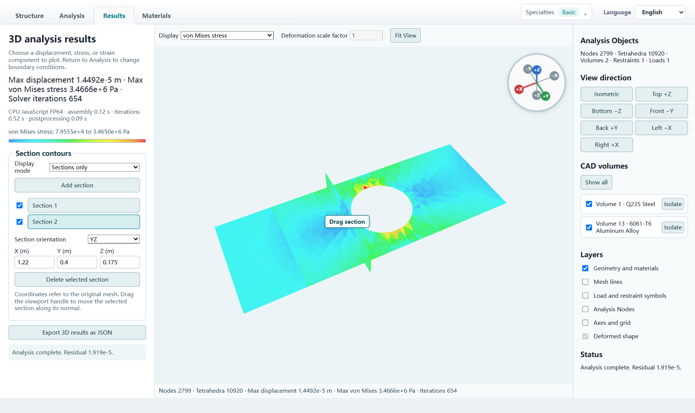
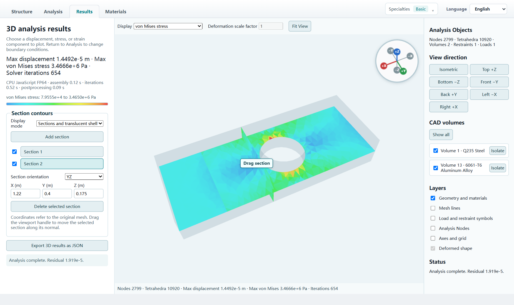
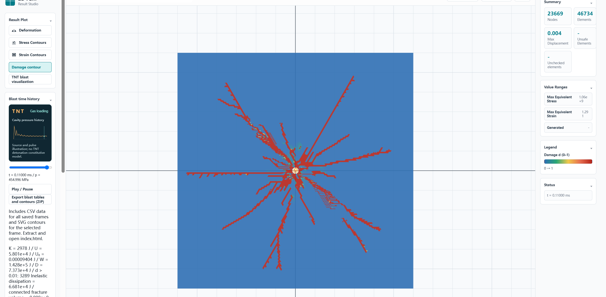

# TENSORA v1.2.1 — 3D Analysis / 三维计算

## English

- **3D modeling and statics.** Import STEP, build solids, extrude a closed 2D profile or cut an existing body, assign materials by volume, and apply restraints and loads before solving on TET4 meshes.
- **Interior results.** Show displacement, stress, strain and safety checks on one or more sections. Set a plane by coordinates and normal or drag it in the viewport.
- **Larger meshes and faster solving.** Up to 350,000 nodes and 1,500,000 tetrahedra. Parallel HXT meshing and binary transfers reduce overhead. Choose CPU or OpenCL FP64 GPU for iteration, or let the automatic mode attempt GPU from 1.2 million elements. GPU failures fall back to CPU.
- **Other workspaces.** 2D statics supports directional constraints and ZZ adaptive refinement. The deformation workspace supports CalculiX J2 plasticity and loading playback, plus optional PhAST AT2 fracture. The blast workspace displays transient stress waves, contours and time histories.

Download **`TENSORA-v1.2.1-windows-x64.zip`**, extract it completely, and run **`TENSORA.exe`**. The ZIP includes Chromium, Node.js, Gmsh, CalculiX and the native solvers. Optional PhAST fracture requires its own Python environment. Double-precision GPU solving requires a compatible driver. The accompanying SHA-256 file verifies the ZIP.

## 中文

- **三维建模与静力学。** 支持 STEP、参数化实体、二维闭合草图拉伸与切削，可逐体域赋材、设置约束和载荷，并在 TET4 网格上求解。
- **内部结果。** 可查看一个或多个剖面上的位移、应力、应变与安全校核。剖面可按坐标和法向设置，也可在视窗拖动。
- **更大的网格与更快的求解。** 上限为 35 万节点和 150 万四面体。采用多线程 HXT 和二进制传输。可选择 CPU、OpenCL FP64 GPU，或在自动模式下从 120 万单元起尝试 GPU，失败时回退 CPU。
- **其他工作区。** 二维静力学支持方向约束和 ZZ 自适应加密。损伤变形工作区支持 CalculiX J2 塑性、加载回放及可选 PhAST AT2 断裂。爆破工作区提供瞬态应力波、云图和时程查看。

下载 **`TENSORA-v1.2.1-windows-x64.zip`**，完整解压后双击 **`TENSORA.exe`**。ZIP 包含 Chromium、Node.js、Gmsh、CalculiX 和原生求解器。可选的 PhAST 断裂功能需要单独配置 Python 环境，双精度 GPU 求解需要兼容驱动。随附 SHA-256 文件可校验 ZIP。

## Demonstrations / 功能演示

[Full bilingual application tour / 完整双语功能导览](../../README.md#application-tour--功能演示)

The XY mid-thickness section and the adjacent YZ section show von Mises stress around the hole and through the thickness on a shared color scale. / XY 中厚面和相邻的 YZ 横剖面共用色标，显示孔缘及厚度方向的 von Mises 应力分布。

**Sections only / 仅显示剖面**

**Sections and translucent shell / 剖面与透明外壳**

- **2D statics / 二维静力学** · [Mode I opening / 一型裂纹张开](https://github.com/Sakihandser/TENSORA/blob/v1.2.1/assets/demo/v1.2.1/mode-i-en.png) · [Mode II shear / 二型裂纹剪切](https://github.com/Sakihandser/TENSORA/blob/v1.2.1/assets/demo/v1.2.1/mode-ii-en.png) · [Safety check / 安全校核](https://github.com/Sakihandser/TENSORA/blob/v1.2.1/assets/demo/v1.2.1/safety-en.png)
- **Damage and deformation / 损伤变形** · [AT2 crack propagation / AT2 相场裂纹扩展](https://github.com/Sakihandser/TENSORA/blob/v1.2.1/assets/demo/v1.2.1/deformation-en.png) · [J2 plastic strain / J2 塑性应变](https://github.com/Sakihandser/TENSORA/blob/v1.2.1/assets/demo/v1.2.1/plastic-en.png)
- **Materials / 材料** · [Shared material library / 共享材料库](https://github.com/Sakihandser/TENSORA/blob/v1.2.1/assets/demo/v1.2.1/materials-en.png)

### Blast dynamics / 爆破动力学

At 110 µs, the damage contour shows how damage is distributed around the cavity. The viewer also displays the cavity pressure history and supports frame playback. / 110 微秒时刻的损伤云图展示空腔周围的损伤分布。结果页同时显示空腔压力时程，并支持逐帧回放。

## Validation and scope / 验证与范围

The 3D end-to-end check solved and transferred results for approximately 1.41 million tetrahedra. The CPU/GPU comparison used the same mesh and matched analytical displacement and force balance. 3D analysis is small-strain linear elastic. The optional AT2 and CalculiX damage indicators are different quantities. The demonstrations are numerical examples. / 三维完整流程验证了约 141 万四面体的求解和结果传输，CPU 与 GPU 同网格对照符合解析位移与力平衡。三维计算采用小变形线弹性。可选 AT2 和 CalculiX 的损伤指标含义不同。演示图为数值算例。

[3D guide / 三维计算指南](https://github.com/Sakihandser/TENSORA/blob/v1.2.1/docs/SOLID_3D.md) · [Changelog / 更新日志](https://github.com/Sakihandser/TENSORA/blob/v1.2.1/CHANGELOG.md) · [Compare v1.2.0…v1.2.1 / 查看版本差异](https://github.com/Sakihandser/TENSORA/compare/v1.2.0...v1.2.1)
