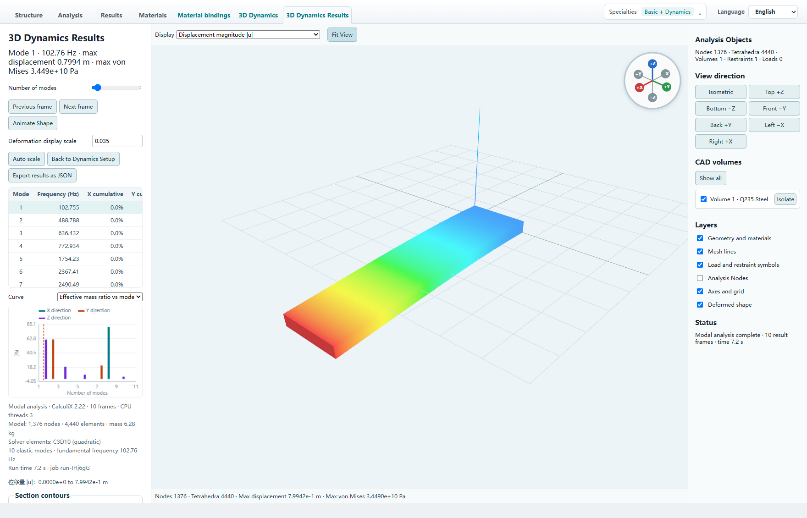
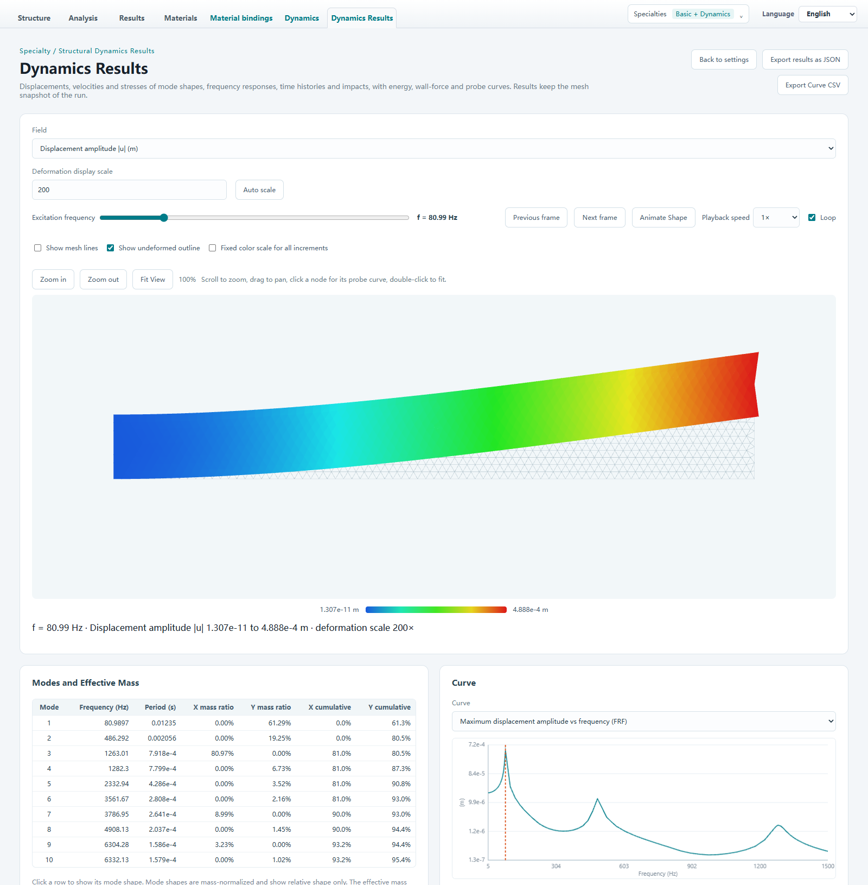
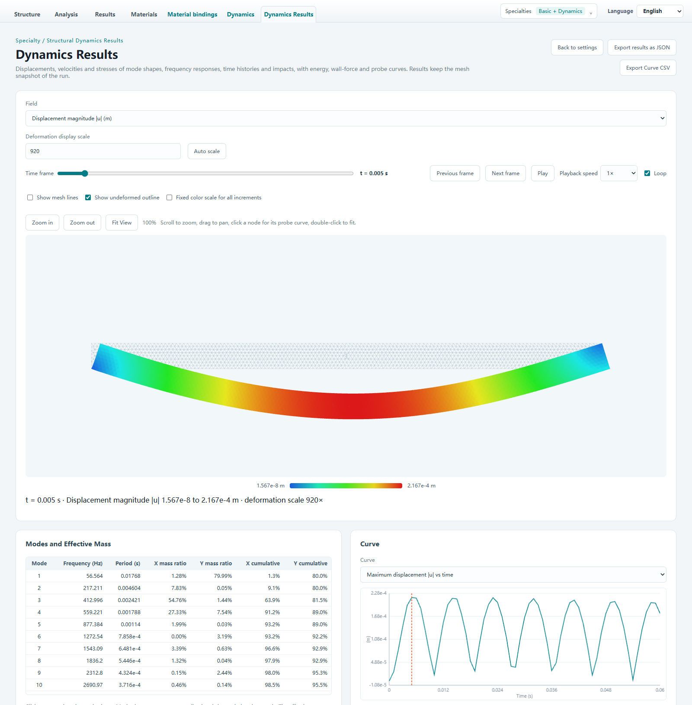
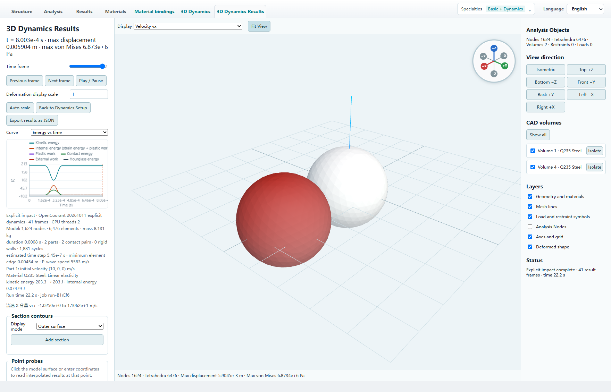

# TENSORA v1.2.8

[Compare v1.2.7 → v1.2.8 / 完整代码对比](https://github.com/Sakihandser/TENSORA/compare/v1.2.7...v1.2.8)

## English

### Structural dynamics in 2D and 3D

Enable **Dynamics** under **Specialties**. The workspace uses the common geometry, mesh, materials, loads and restraints. Analysis settings are saved with the model JSON.

- **Modal analysis.** CalculiX extracts natural frequencies and mode shapes and reports periods, participation factors, and effective and cumulative modal masses. Rigid-body modes are identified from connected components and independent restraint directions.
- **Harmonic response.** Sweep a frequency range under sinusoidal loading. Review the frequency-response curve, animate displacements with each component’s phase, and inspect the analytical peak von Mises stress over a cycle.
- **Implicit transient analysis.** Choose modal superposition or direct integration, with Rayleigh damping and step, ramp, sinusoidal, pulse or tabulated load histories. Both methods reach the specified end time when the requested increment does not divide the duration evenly. Result frames and node probes use solver timestamps.
- **Explicit impact.** OpenCourant supports separate parts, initial velocities, contact, friction and fixed rigid walls. Review displacements, velocities and stresses, plus plastic strain, damage, energy histories and wall reactions where available. The 2D explicit model uses plane strain.
- **Results and export.** Play mode shapes and time histories, inspect nodal curves, and export results as JSON and available curves as CSV. The guide describes the supported modeling assumptions, solver settings and verification cases. [Structural dynamics guide](https://github.com/Sakihandser/TENSORA/blob/v1.2.8/docs/DYNAMICS.md)

### Local automation without an application window

- Run `TENSORA.exe --headless` to start the service on loopback, with port **5183** by default. `GET /api/automation` advertises available operations. The service can process models and solver requests before any browser engine starts.
- `POST /api/automation/session` starts an on-demand headless workspace for clients that use CDP, including drawing and result-view operations. `TENSORA.exe --stop-headless` stops the service and its worker processes. [Headless interface](https://github.com/Sakihandser/TENSORA/blob/v1.2.8/docs/WINDOWS_LAUNCHER.md#后台自动化接口)

### CPU threading

- The static and deformation workspaces accept an automatic setting or a manual limit of 1–64 CPU threads, bounded by the available logical processors. The 2D static solver parallelizes element work and can use oneMKL PARDISO on larger meshes. The native 3D static solver parallelizes CPU iterations.
- Deformation runs propagate thread settings to the applicable CalculiX, Code_Aster, OpenCourant and PhAST runtimes. The bundled OOFEM runtime uses one thread.

### Windows x64 portable download

Download **TENSORA-v1.2.8-windows-x64.zip**, extract the entire archive, and run **TENSORA.exe** inside the extracted folder. The accompanying **.sha256** file gives the SHA-256 checksum of the ZIP.

## 中文

### 二维与三维结构动力学

在**专业计算**中启用**结构动力学**。工作区沿用公共几何、网格、材料、载荷和约束，分析设置随模型 JSON 保存。

- **模态分析。** CalculiX 提取固有频率与振型，并给出周期、参与因子、模态有效质量与累计占比。程序按网格连通部件和独立约束方向识别刚体模态。
- **谐响应。** 在指定频率范围内计算简谐载荷下的稳态响应。可查看频响曲线、按各分量相位播放位移动画，并查看一个周期内解析计算的 von Mises 应力峰值。
- **隐式瞬态。** 支持模态叠加和直接积分，可设置瑞利阻尼以及阶跃、斜坡、正弦、脉冲和表格载荷时程。给定步长不能整除计算时长时，两种方法均到达指定终止时间。结果帧和节点测点采用求解器输出的时间。
- **显式碰撞。** OpenCourant 支持多个独立部件、初速度、接触、摩擦和固定刚性墙。可检查位移、速度和应力，并按算例读取塑性应变、损伤、能量时程和墙反力。二维显式模型采用平面应变。
- **结果与导出。** 支持振型和时程播放、节点曲线、结果 JSON 及可用曲线的 CSV 导出。指南包含建模假设、求解设置和验证算例。[结构动力学指南](https://github.com/Sakihandser/TENSORA/blob/v1.2.8/docs/DYNAMICS.md)

### 无窗口后台自动化

- 运行 `TENSORA.exe --headless` 启动仅监听本机的 HTTP 服务，默认端口 **5183**。通过 `GET /api/automation` 查询可用操作。外部程序可以直接提交模型和求解请求，按需启动浏览器引擎。
- 需要绘图或结果页操作时，可用 `POST /api/automation/session` 创建无界面工作区，再通过 CDP 连接。运行 `TENSORA.exe --stop-headless` 停止服务及其工作进程。[后台接口说明](https://github.com/Sakihandser/TENSORA/blob/v1.2.8/docs/WINDOWS_LAUNCHER.md#后台自动化接口)

### CPU 多线程

- 静力学与损伤变形支持自动选取线程数，也可设置 1–64 的手动上限，实际值受可用逻辑处理器限制。二维静力并行计算单元，并可在较大网格调用 oneMKL PARDISO。三维原生静力求解器并行执行 CPU 迭代。
- 损伤变形将线程设置传递给适用的 CalculiX、Code_Aster、OpenCourant 和 PhAST 运行时。随包 OOFEM 使用单线程。

### Windows x64 便携版下载

下载 **TENSORA-v1.2.8-windows-x64.zip**，完整解压后运行目录中的 **TENSORA.exe**。使用同页的 **.sha256** 文件核对 ZIP 的 SHA-256 校验值。

## Application views / 软件截图

| Modal analysis / 模态分析 | Harmonic response / 谐响应 |
| --- | --- |
|  |  |

| Implicit transient / 隐式瞬态 | Explicit impact / 显式碰撞 |
| --- | --- |
|  |  |

[More dynamics views / 更多动力学截图](https://github.com/Sakihandser/TENSORA/blob/v1.2.8/README.md#structural-dynamics--结构动力学)
